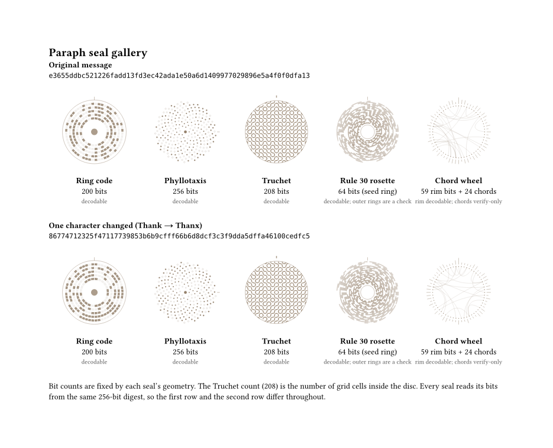

# paraph

Data seals for Typst letters: a small circular mark that is a visual fingerprint of your letter's text. Change a single character and the seal changes.



Five styles are included. They are all drawn as vector graphics, so they stay sharp at any size.

| Seal | Bits | Decodable from a scan? |
|---|---|---|
| `ring` | 200 | Yes |
| `phyllotaxis` | 256 | Yes (the full digest) |
| `truchet` | 208 | Yes |
| `rule30` | 64 (seed ring) | Yes; the outer rings are a deterministic check |
| `chord` | 59 rim bits + 24 chords | Rim bits yes; the chords can verify a known message but not decode one |

> **paraph is not cryptographic.** The hash is a simple non-secure function that maps text to 256 bits so every letter gets its own mark. Anyone can construct two texts with the same seal on purpose. Do not use a seal as a signature or proof of authenticity. (See "Future work" below for signing.)

Requires Typst 0.14 or newer. CI runs on 0.14.0; development used 0.15.1.

## Install

Once published, `#import "@preview/paraph:0.1.0": *`. Until then, use it as a local package: clone this repository and link it into Typst's data directory.

```bash
mkdir -p "$HOME/Library/Application Support/typst/packages/local/paraph"
ln -s "$PWD" "$HOME/Library/Application Support/typst/packages/local/paraph/0.1.0"
```

(On Linux the directory is `~/.local/share/typst/packages/local/paraph/0.1.0`.) Then `#import "@local/paraph:0.1.0": *`.

## Quick start

```typst
#import "@local/paraph:0.1.0": *

#let source = (
  sender: "Aaron Meyer", recipient: "Dr. J. Smith",
  date: "4 November 2026", body: read("body.txt"),
)

// A seal in the bottom-right corner of the page, with its first 8 hex digits printed below
#set page(..seal-page(source, kind: "ring", alignment: bottom + right,
                      dx: -0.8in, dy: -0.6in, size: 1in, caption: true))

Dear Dr. Smith, ...
```

`examples/letter.typ` is a complete letter built this way; `examples/gallery.typ`, `examples/styling.typ`, `examples/placement.typ` and `examples/content-source.typ` show the rest.

## What is sealed (the `source`)

Every function takes a `source`: anything that describes the text to fingerprint.

| Type | How it is used |
|---|---|
| `str` | The text, after normalization |
| `bytes` | Used raw (e.g. `read("body.txt", encoding: none)`), with no normalization |
| `content` | Flattened to its plain text first (formatting is ignored), then normalized |
| `array` | Each element handled as above; element boundaries matter |
| `dictionary` | Like an array of key/value pairs, in insertion order. The keys matter too |

A dictionary is the recommended pattern for a letter: fields stay separate, so moving a word from the recipient into the date still changes the seal.

**Normalization** (default; `message(..., normalize: "none")` turns it off): line endings become `\n`, whitespace at the start and end of every line is removed, three or more newlines collapse to a blank line, and the text is trimmed at both ends. Typst has no Unicode normalization, so supply NFC text.

**Caveats**
- Flattening `content` depends on how Typst represents elements, so the same `content` could give a different seal after a Typst upgrade. For a seal that must never change, pass a `str` or `bytes`.
- The `body.txt` pattern (read it once, hash it and also typeset it) is the most robust way to seal a letter.

## Seals

```typst
#seal(source, kind: "ring", ..options)   // kind: "ring" | "phyllotaxis" | "truchet" | "rule30" | "chord"
#ring-seal(source, ..options)            // or call a kind directly
#phyllotaxis-seal(..)  #truchet-seal(..)  #rule30-seal(..)  #chord-seal(..)
#seal-digest(source)                     // the 64-character hex digest every seal encodes
```

### Options shared by every seal

| Option | Default | Meaning |
|---|---|---|
| `size` | `1.1in` | Side of the square box the seal is drawn in |
| `ink` | `rgb("#684c2e")` | Main colour (a plain colour, no gradients) |
| `ink-off` | `auto` (same as `ink`) | Colour for 0-bits and empty marks |
| `strength` | `1.0` | Multiplies every mark's opacity; the result is clamped to 1 |
| `stroke-scale` | `1.0` | Multiplies every line width |
| `paper` | `none` | Colour used to mask marks (Truchet's edge); see below |
| `rotation` | `0deg` | Rotates the whole seal; the orientation mark turns with it |
| `orientation` | `true` | Draw the orientation mark. Decoders need it |
| `boundary` | `true` | Draw boundary rings where the seal has them (phyllotaxis and chord have none) |
| `background` | `none` | Fill behind the seal: a colour |
| `background-shape` | `"disc"` | `"disc"` or `"square"` |
| `salt` | `""` | Mixed into the hash, so the same text can give a different seal |

Per-seal extras: `ring-seal` takes `gap` (fraction of a cell left empty between cells, default `0.16`). `truchet-seal` defaults to `paper: white`; see its section.

`seal()` and `seal-at()` also take `caption`, `caption-text`, `caption-size` (`5pt`), `caption-font` (a monospace) and `caption-gap`. `caption: true` prints the first 8 hex digits of the digest under the seal; the caption never widens the box.

## Placement

```typst
#seal-at(source, alignment: bottom + right, dx: 0pt, dy: 0pt, pages: "all", kind: "ring", ..)
#seal-page(source, layer: "foreground", ..)   // returns a dictionary for `set page(..)`
```

Seals are placed out of the flow, so they never reflow your text. Where `seal-at` lands depends on where you put it:

- Inside `set page(foreground: ..)` or `background: ..` (that is what `seal-page` produces): relative to the whole page, ignoring margins.
- In the document body: relative to the text area of the page where it appears.

`pages` limits which pages show it: `"all"`, `"first"`, `"last"`, a 1-based integer (negative counts from the end), an array of those, or a function from the page number to a bool. "Last" uses `counter(page).final()`, so it assumes the page counter has not been reset. To stack several seals, use `foreground: seal-at(..) + seal-at(..)`.

See `examples/placement.typ` for a 3-page example.

## Encoding specification

This is the full specification, so a seal can be read without the source code.

### Message and digest

1. **Message.** Build a byte string: the tag `paraph-v1\n`, then the source. A `str` or `content` becomes its normalized text. A `bytes` is used raw. An array joins its elements with the byte `0x1E`. A dictionary joins its entries with `0x1E`, and each entry is `key`, then `0x1F`, then the value.
2. **Digest.** 256 bits as 32 bytes, from eight 32-bit words (run `r` = 0 to 7), each: start with `h = 2166136261`. For each byte `b` of `str(r) + "|" + salt + "|"` followed by the message: `h = ((h XOR b) * 16777619) mod 2^32`. Then twice: `h = h XOR (h >> 16)`, then `h = (h * 73244475) mod 2^32`. Finally `h = h XOR (h >> 16)`. The word is written big-endian. The 32 bytes are the words in run order.
3. **Bit order.** Bit `i` of the digest is bit `7 - (i mod 8)` of byte `i / 8`, so bits run MSB-first within each byte.

### Geometry

`R = 0.40 * size`, the centre is the middle of the square, and angles are clockwise from 12 o'clock unless stated. Line widths are fractions of `R`, multiplied by `stroke-scale`. Opacities are multiplied by `strength` and clamped to 1; they are tuned for a screen and will be revisited after a print test.

**Ring code** (200 bits). Five tracks, with 24, 32, 40, 48 and 56 cells; the bits are read from digest bit 0, track by track (innermost first), clockwise from 12 o'clock, so track `t` starts at bit 0, 24, 56, 96 or 144. Track centrelines are evenly spaced from `0.36R` to `0.92R`; each cell is an arc stroked at `0.58` of the track width, with a gap of `0.16` of a cell. A 1-bit is a dark arc (opacity 0.60), a 0-bit a faint one (0.08). Boundary circle at `0.98R`. **Orientation:** a tick from `0.98R` to `1.08R` at 12 o'clock. Centre dot of radius `0.10R`.

**Phyllotaxis** (256 bits). Seed `i` (0 to 255) carries bit `i`. It sits at radius `c * sqrt(i + 4)` and angle `i * golden angle` (`pi * (3 - sqrt 5)`), measured from **3 o'clock** (+x) and increasing clockwise on screen, where `c = 0.94R / sqrt(260)`. A 1-bit is a filled dot of radius `c * (0.30 + 0.10 * i / 256)`; a 0-bit is a ring of that radius. **Orientation:** a tick pointing to 3 o'clock, from `0.975R` to `1.055R`. There is a small filled centre dot. No boundary ring.

**Truchet** (208 bits). A 16 by 16 grid of cells, side `2 * 0.94R / 16`, centred on the seal. A cell is read if its centre is within `0.94R + 0.2 * side` of the centre; that is **208 cells**. Cells are read row by row, top to bottom and left to right, from digest bit 0. Bit 1: quarter arcs (radius half a side) centred on the top-left and bottom-right corners of the cell. Bit 0: arcs centred on the top-right and bottom-left corners. **Orientation:** a notch at 12 o'clock from `1.05R` to `1.12R`. Boundary circle at `0.96R`. Everything outside it is covered by a `paper`-coloured annulus; the default is `paper: white`, so if the letter or the seal's `background` is not white, pass that colour as `paper`. `paper: none` turns the mask off, but tiles then poke out of the circle.

**Rule 30 rosette** (64 bits). Ring 0 is digest bits 0 to 63, one cell per 1/64 of a turn, clockwise from 12 o'clock. Each outer ring is the Rule 30 cellular automaton applied to the previous one, with wrap-around: `new[i] = (30 >> (4*left + 2*centre + right)) & 1`. There are 22 rings, ring `g` spanning radii `r0 + g * dr` to `r0 + (g + 0.92) * dr`, with `r0 = 0.26R` and `dr = (0.96R - r0) / 22`. Only ring 0 carries data; the others let a decoder sanity-check its reading of ring 0. **Orientation:** a tick at 12 o'clock from `0.98R` to `1.08R`.

**Chord wheel** (59 bits plus verify-only chords). Sixty points sit on a circle of radius `0.80R`, point 0 at 12 o'clock, 6 degrees apart. Rim ticks start at `0.86R` and point outward. **Tick 0 is the orientation mark**, always `0.20R` long. Tick `i` (1 to 59) reads digest bit `i`: `0.13R` long for a 1, `0.06R` for a 0. (Digest bit 0 is unused.) There are also 24 chords, for `k` = 0 to 23: `a = byte(k) mod 60`, `b = (a + 3 + byte(k + 8) mod 54) mod 60`, a quadratic curve between rim points `a` and `b` whose control point is the chord midpoint pulled to 35% of its distance from the centre. **The chords are verify-only:** the modulo steps discard information, and the direction from `a` to `b` is ambiguous in a scan. They can confirm a known message but cannot decode one.

### Sample message

For `(sender: "Aaron Meyer", recipient: "J. Smith", date: "2026-11-04", body: "Test.")`:

- Digest: `35062afecba3fea207c29febf91f9b0de434500267aefde691ee7d063bda2eae`
- The first 16 bits read by the ring, phyllotaxis, Truchet seals and by Rule 30's ring 0: `0011010100000110`
- The first 16 bits of the chord wheel's rim (digest bits 1 to 16): `0110101000001100`

`tests/bits-dump.typ` prints every bit each seal reads for this message, and `tests/check_dump.py` checks it against an independent Python implementation of the encoding in `tests/reference.py`.

## Development

Examples and tests import the package directly with `#import "../lib.typ": *`. To compile everything CI does:

```bash
mkdir -p out && for f in tests/*.typ examples/*.typ; do typst compile --root . "$f" "out/$(basename "$f" .typ).pdf"; done
python3 tests/check_dump.py
```

## Future work

Error correction, a decoder, signing and a document-wide mode are tracked as separate issues in this repository.

## License

MIT-0
